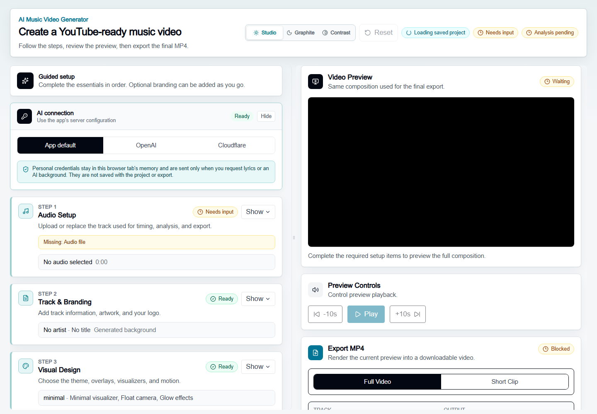

# AI Music Video Generator

A browser-based creator for turning an audio track, artwork, and track details
into a reactive 1080p music video. The Remotion player is the official preview,
so the composition shown in the editor uses the same data as the exported MP4.

## Live Demo

[Open AI Music Video Generator](https://ai-music-video-generator-nine.vercel.app/)

The hosted app includes the editor, preview, and AI tools. MP4 export currently
runs in the local app; the hosted version does not have a render worker connected.

## Screenshots

### Creator workspace



## Features

- Drag-and-drop audio, background, and logo uploads
- Local audio analysis for energy, onsets, drops, and reactive arrangements
- Multiple independently positioned, scaled, rotated, and colored visualizers
- Configurable titles, captions, timer, and styled progress bars
- Provider-timed lyric captions with a manual-text fallback
- Editable caption timing and a whole-track timing shift
- Local background templates with optional OpenAI or Cloudflare generation
- Optional lyric transcription through OpenAI or Cloudflare Workers AI
- Manual, Random, and section-aware Auto visual modes
- Browser-saved visual presets with JSON import and export
- Autosave after edits, manual saving, and shared App default AI credits
- Local MP4 rendering through Remotion
- Studio, Graphite, and high-contrast interface themes

AI credentials are optional. Uploading audio and editing a video do not require
an API key; Auto Director also works from local audio analysis when lyrics are
not available.

## Tech Stack

- Next.js 16 and React 19
- TypeScript
- Tailwind CSS 4
- Remotion Player, Bundler, and Renderer
- Web Audio API
- OpenAI Images/Audio APIs and Cloudflare Workers AI as optional providers

## Getting Started

### Requirements

- Node.js 20 or newer
- npm
- A Chromium-based browser is recommended for media preview

### Install and run

```bash
git clone https://github.com/hxvMI/ai-music-video-generator.git
cd ai-music-video-generator
npm install
npm run dev
```

Open [http://localhost:3000](http://localhost:3000). If that port is occupied,
Next.js prints the alternate local URL in the terminal.

### Optional AI providers

For a personal connection, select OpenAI or Cloudflare under **AI connection**
and enter your credentials there. No server setup or D1 database is needed.
Credentials stay in the current tab's memory and are not saved with projects,
presets, or exported videos.

To offer **App default** to everyone using your deployment, copy `.env.example`
to `.env.local` and configure Cloudflare plus the shared-credit ledger:

```env
# Cloudflare App default and its shared request-credit ledger
AI_PROVIDER=cloudflare
CLOUDFLARE_ACCOUNT_ID=your_account_id_here
CLOUDFLARE_API_TOKEN=your_workers_ai_token_here
CLOUDFLARE_D1_DATABASE_ID=your_database_id_here
CLOUDFLARE_D1_API_TOKEN=your_d1_write_token_here
APP_AI_DAILY_CREDITS=10
```

Restart the development server after changing `.env.local`. Never prefix these
values with `NEXT_PUBLIC_` and never commit `.env.local`.

App default always uses Cloudflare and requires the D1 shared-credit ledger.
It does not fall back to a server OpenAI key. See [DEPLOYMENT.md](DEPLOYMENT.md)
for account setup. Personal connections continue to work without D1.

The shared balance counts requests, not Cloudflare's remaining compute quota.
The provider can reach its own limit first. Add rate limiting and bot protection
before offering unrestricted public access to your shared connection.

### Lyrics and large audio files

Choose **Transcribe lyrics** in the Captions tab to request a transcript.
Provider timestamps are used when available; untimed text is distributed across
the track as a fallback. Review the words and timing, especially for songs with
heavy effects or long instrumental sections.

Audio uploads above 4 MB are converted to a mono 16 kHz transcription copy in the
browser and sent in 90-second chunks. Caption times are moved back onto the full
song timeline. Your original audio stays unchanged for playback and export.
Each chunk uses one shared credit when App default is selected. If a chunk
fails, retrying restarts transcription and can use additional credits.

### Saving your work

The editor autosaves after a one-second pause following an actual project edit.
Playback, status updates, and theme changes do not write project data. Use Save
for an immediate save, or turn off Autosave for manual saving only.

## How It Works

1. **Audio Setup** decodes the track and creates deterministic analysis points.
2. **Track & Branding** prepares metadata and render-safe image assets.
3. **Visual Design** stores themes, layers, overlays, and reactive zones as
   serializable project configuration.
4. **Video Preview** sends that configuration to the Remotion Player.
5. **Export MP4** sends the same manifest and selected assets to the local
   render-job route, preserving preview/export parity.

The browser UI may use `File`, refs, and local storage. Remotion composition
components receive only serializable configuration and asset URLs so server
rendering does not depend on browser-only objects.

## Project Structure

```text
app/
  api/                 Server routes for AI providers and render jobs
  components/audio/    Upload, metadata, playback, and visual-design controls
  components/remotion/ Remotion composition entry points
  components/video/    Shared preview/export scene and render workflow
  hooks/               Audio analysis, generation, and preview transport state
  lib/                 Pure presets, normalization, manifests, and render helpers
  types/               Shared project and export contracts
remotion/              Remotion bundle entry point
```

## Development Commands

```bash
npm run dev      # Start the local editor
npm run test     # Run automated unit tests
npm run test:browser # Check editor workflows with Playwright
npm run lint     # Run ESLint
npm run build    # Type-check and create a production build
npm run start    # Serve the production build
```

Run the unit tests, lint, and build before opening a pull request. Run the browser
suite for editor changes too. Its current setup uses Microsoft Edge and
`npm.cmd` on Windows; adjust `playwright.config.ts` for another browser or OS.

## Deployment

The project is prepared for a Vercel hosted-preview deployment. The editor,
Remotion preview, local analysis, and background tools fit that model; the
current Chromium/FFmpeg MP4 worker remains local until durable uploads and a
render worker are connected. See [DEPLOYMENT.md](DEPLOYMENT.md) for the exact
capability split and deployment steps.

## Local Data and Privacy

- Media is stored in your browser project. Transcription sends audio to the
  selected AI provider; local MP4 export uploads the chosen assets to the local server.
- Personal API credentials are intentionally excluded from persistence.
- Generated images are stored as data URLs and included in browser-saved projects.
- Render jobs are written to `.render-jobs/`, which is excluded from Git.
- Browser-saved projects and visual presets can be cleared through browser data.

## Contributing

See [CONTRIBUTING.md](CONTRIBUTING.md) for branch, testing, and pull-request
guidance. Bug reports should include browser details, reproduction steps, and
whether the issue affects preview, export, or both.

## Project Status

The editor, AI backgrounds, timed captions, reactive arrangements, browser saves,
and local MP4 workflow are functional. Hosted transcription supports large
tracks through chunked uploads. AI output still needs review, and browser storage
is not a cloud backup.

Remaining deployment work includes public-use abuse protection and an online
render backend. Online MP4 export is not available yet.

## License

No license has been selected yet. Until one is added, copyright remains with
the project owner and the repository should not be treated as open source.
